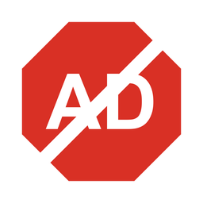

<div align="center">



# My AdBlock

**A lightweight Chrome extension that blocks the ads other blockers miss, especially Twitch stream ads.**


</div>

---

## Why?

Most free ad blockers work well on normal websites and YouTube, but **Twitch puts its ads directly inside the live video stream**, so blocking ad servers does nothing. My AdBlock was built to fix that, and it also handles Kick and YouTube.

It works great **alongside** a big list-based blocker (like AdBlock or uBlock Origin Lite): let that one handle the general web, and let this one handle the streaming sites.

## Features

- 🎮 **Twitch stream ads.** Replaces ad breaks with an ad-free copy of the stream, or cuts the ads out.
- 🟩 **Kick video ads.** Blocks Kick's video ad system.
- ▶️ **YouTube ads.** Removes ads from the video data and auto-skips anything that gets through.
- 🛡️ **Ad and tracker servers.** Blocks ~70 of the most common ad networks and trackers on every site.
- 🧹 **Empty ad boxes.** Hides leftover ad slots so pages look clean.
- 🔢 **Blocked counter** on the toolbar icon.
- ⏸️ **Pause per site** with one click.
- 🪶 **No dependencies, no build step, no data collection.** Plain JavaScript you can read in a few minutes.

## Installation

1. Download this repository (**Code → Download ZIP**, then unzip) or clone it:
   ```bash
   git clone https://github.com/Cukrovec/my-adblock.git
   ```
2. Open `chrome://extensions` in Chrome.
3. Turn on **Developer mode** (top right).
4. Click **Load unpacked** and select the `my-adblock` folder.
5. Pin the extension to your toolbar. Done!

> Works in Chrome 111+ and other Chromium browsers (Edge, Brave, Opera).

## How it works

### Twitch
The Twitch player downloads a short playlist of video pieces every couple of seconds. My AdBlock checks each playlist:

1. **Ad detected?** It asks Twitch for the same stream as a different player type (`embed`, `popout`, `autoplay`), which often comes without ads, and plays that instead.
2. **Still ads everywhere?** It removes the ad pieces, so the stream briefly buffers instead of showing the ad.

A small *"skipping ad break…"* label shows on the player while this happens.

### YouTube
Removes the ad list (`adPlacements`, `playerAds`, …) from YouTube's video data before the player reads it. If an ad still starts, it gets muted, skipped to the end, and the **Skip** button is clicked automatically.

### Everything else
Chrome's built-in [`declarativeNetRequest`](https://developer.chrome.com/docs/extensions/reference/api/declarativeNetRequest) API blocks requests to known ad and tracker domains, and a small stylesheet hides empty ad containers.

## Project structure

```
my-adblock/
├── manifest.json          # Extension config
├── background.js          # Blocked counter, script registration, per-site pause
├── rules.json             # Blocked ad & tracker domains
├── popup.html / popup.js  # Toolbar popup
├── icons/                 # Extension icons
└── content/
    ├── twitch-main.js     # Twitch stream ad blocking
    ├── youtube-main.js    # Removes ads from YouTube video data
    ├── youtube-skip.js    # Auto-skips YouTube ads that get through
    └── cosmetic.js        # Hides leftover ad boxes
```

## Customizing

- **Block another domain:** add it to a `requestDomains` list in `rules.json`.
- **Hide another ad box:** right-click it → **Inspect**, then add its CSS selector to `content/cosmetic.js`.
- **Twitch ads came back?** Twitch changes its ad system from time to time. Open DevTools (F12) → **Network**, filter by `m3u8`, open a playlist during an ad, and add any new ad markers to `AD_MARKERS` in `content/twitch-main.js`.

After any change, click ↻ on the extension in `chrome://extensions` and reload the page.

## Disclaimer

This is a personal hobby project and isn't affiliated with Twitch, Kick, YouTube or Google. Sites change often, so things may break. Issues and pull requests are welcome! Consider supporting your favorite creators in other ways, like subscriptions or donations. 💜

## License

[MIT](LICENSE)
